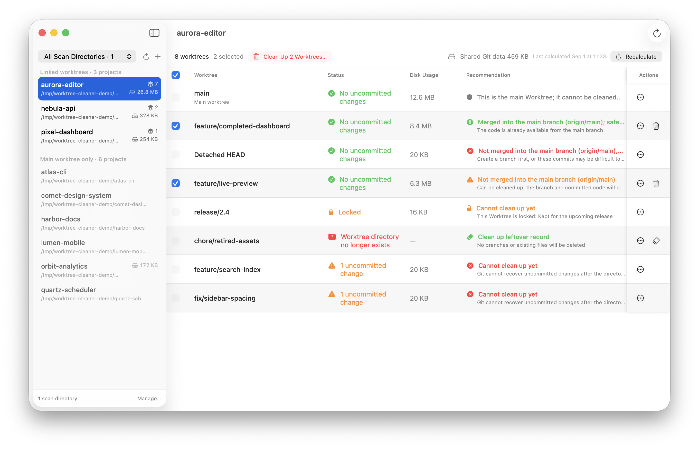
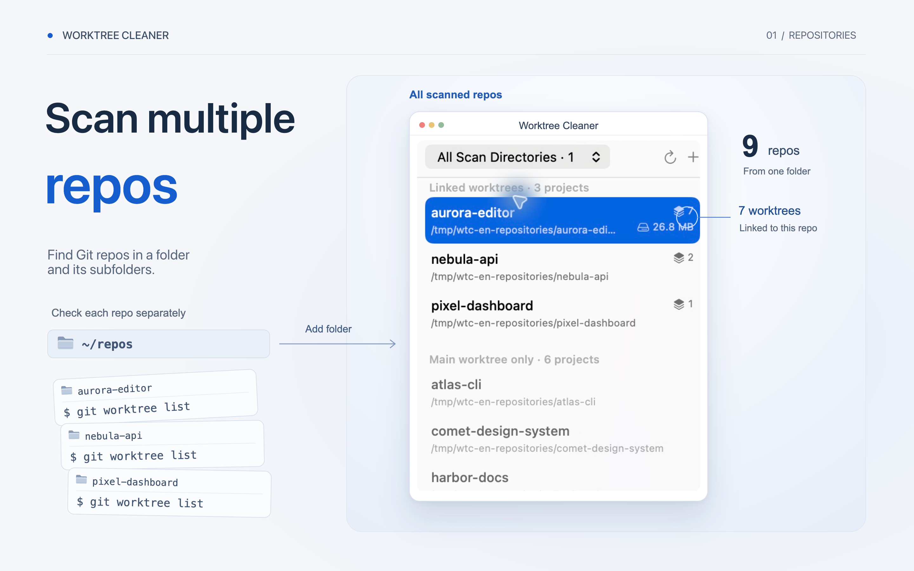
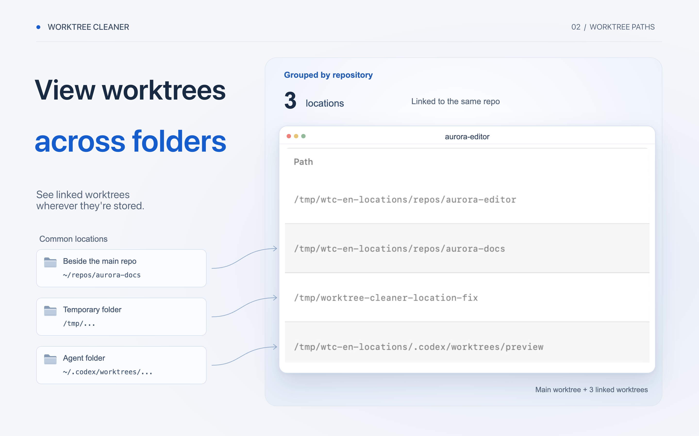
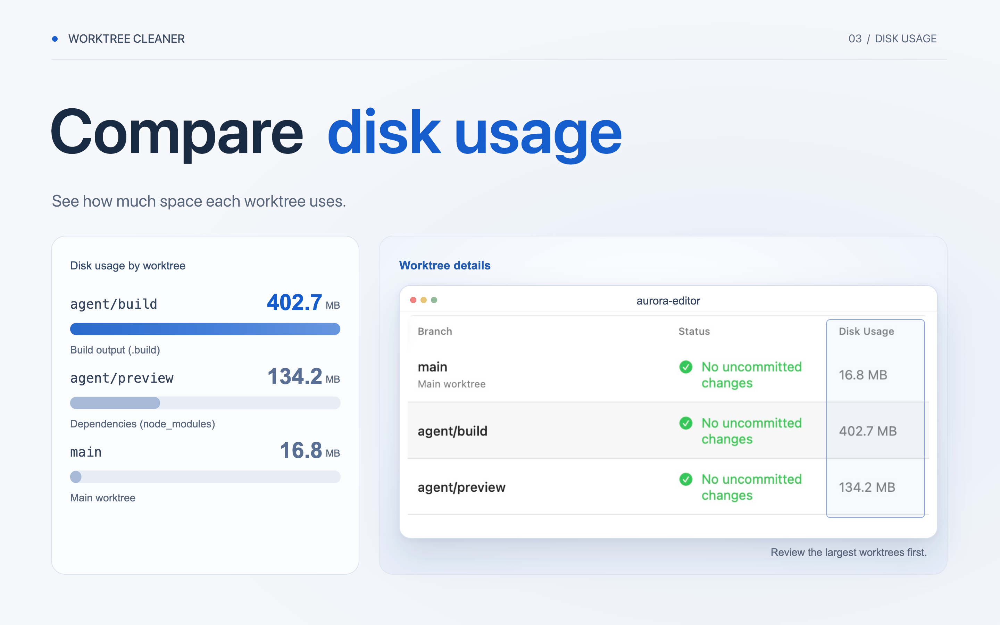
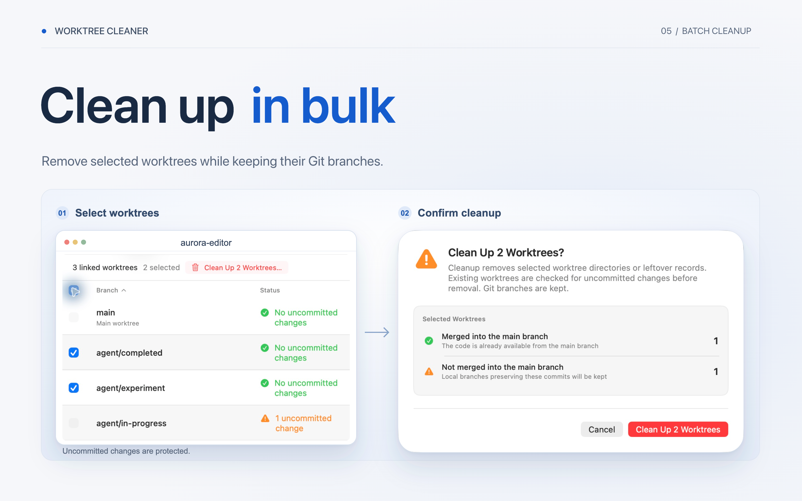
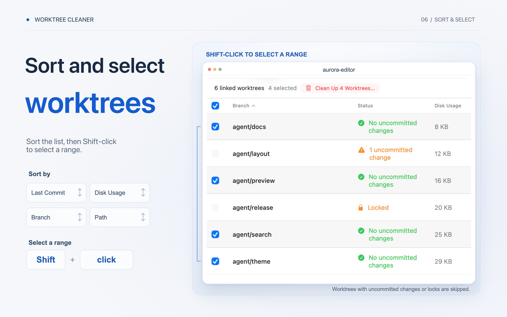

  

# Worktree Cleaner

Worktree Cleaner is a free, open-source, lightweight native macOS app for safely
cleaning up Git worktrees across projects.

See what is safe to remove, reclaim disk space, and keep branches and uncommitted
work protected.

  <strong><a href="https://github.com/vincentbel/worktree-cleaner/releases/download/v0.1.2/WorktreeCleaner-0.1.2.dmg">Download Worktree Cleaner 0.1.2</a></strong>

  

## Features

<table>
  <tr>
    <td width="50%">
      
    </td>
    <td width="50%">
      
    </td>
  </tr>
  <tr>
    <td width="50%">
      
    </td>
    <td width="50%">
      
    </td>
  </tr>
  <tr>
    <td width="50%">
      
    </td>
    <td width="50%">
      
    </td>
  </tr>
</table>

## Safety guarantees

- **State is rechecked immediately before removal.**
- **Worktrees are never force-removed, and branches are never deleted.**
- **Main, dirty, and locked worktrees are blocked.**
- A clean unmerged worktree can be removed when its branch keeps the commits
  reachable. An unmerged detached HEAD is blocked until you create a branch.

## Install

Download the signed and notarized [Worktree Cleaner 0.1.2 DMG][download].
Open it, drag `WorktreeCleaner.app` onto the **Applications** shortcut, then
launch the app from Applications and eject the disk image.

Requires **macOS 14 or later** and Git at `/usr/bin/git`.

## Getting started

1. Add one or more directories containing Git projects.
2. Select a project and review its worktrees and recommendations.
3. Click **Last Commit**, **Disk Usage**, **Branch**, or **Path** to sort; click
   again to reverse the order. The default is oldest commit first.
4. Select eligible worktrees with the checkboxes. Hold **Shift** while clicking
   another checkbox to select or deselect the range, then clean up individually
   or in a batch.

**Last Commit** shows the current HEAD commit's committer time in your local time
zone. Uncommitted file edits do not change this time. The main worktree stays
first when sorting, and unknown dates or disk sizes stay last.

**Scanning is read-only.** Files change only after you explicitly confirm cleanup.

## Project documentation

- [Development](docs/development.md)
- [Architecture and safety decisions](docs/architecture.md)
- [Release process](docs/releasing.md)
- [Edit and export the introduction images](docs/marketing/intro-en/README.md)

[download]: https://github.com/vincentbel/worktree-cleaner/releases/download/v0.1.2/WorktreeCleaner-0.1.2.dmg
